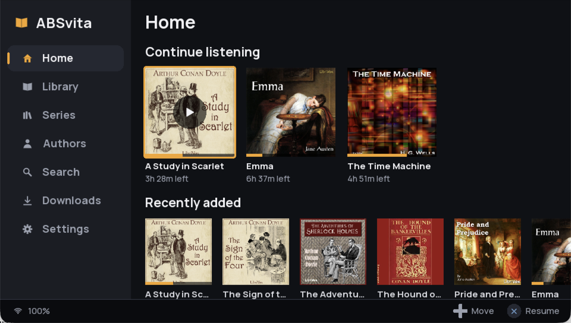
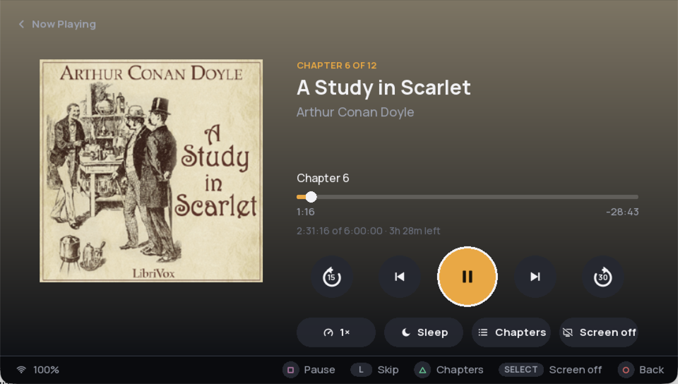
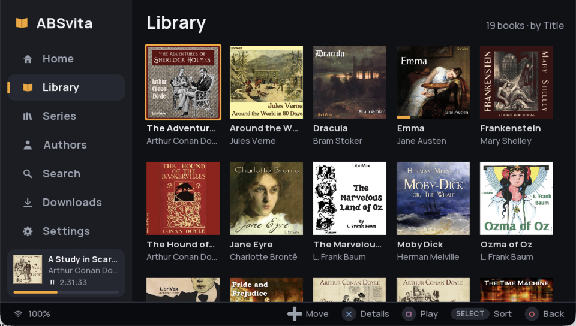
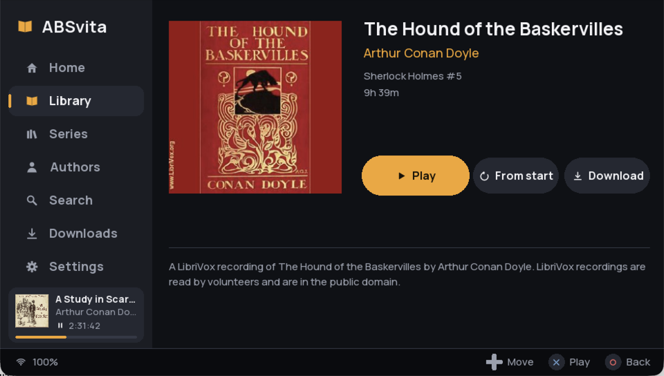
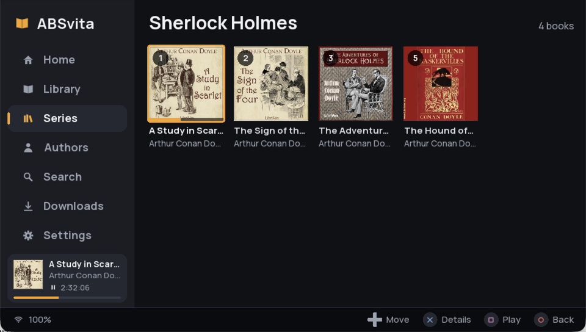
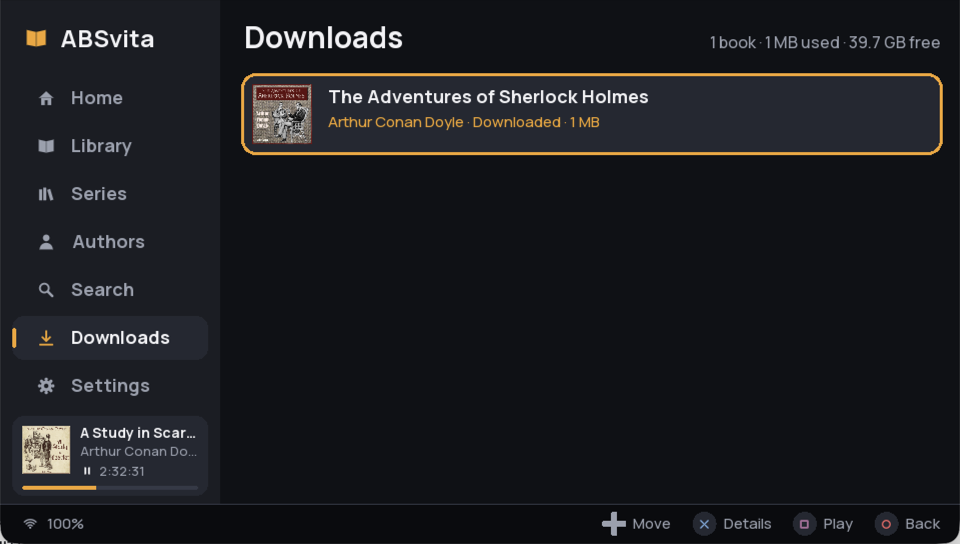

# ABSvita

An [Audiobookshelf](https://www.audiobookshelf.org/) client for the PlayStation Vita.
Stream your audiobooks from your own server, pick up where you left off, and keep
your progress in sync with every other Audiobookshelf app.

- **Plays your books.** M4B, M4A and MP3 (single- or multi-file), streamed from your server.
  Long books start in seconds: the player reads only the parts of the file index it needs
  instead of downloading it first.
- **Easy to drive with buttons.** Everything works with the d-pad and face buttons; touch
  is there when you want it. The bar at the bottom always shows what each button does.
- **Home, Library, Series, Authors, Search and Downloads** on one screen, with a mini player
  in the sidebar.
- **Now Playing** with chapters, skip back/forward, speed (0.75x to 2x), a sleep timer and
  screen-off listening.
- **Downloads for offline listening.** Save books to the memory card from the book page
  (Download, with progress, pause and resume) and play them with no Wi-Fi. The Downloads
  section lists what's saved and how much space is left.
- **Progress sync** with your server's listening sessions, plus an offline queue that
  catches up when you're back online.

| | |
|---|---|
|  |  |
|  |  |
|  |  |

<sub>Screenshots from the Vita3K emulator, showing public-domain [LibriVox](https://librivox.org)
recordings and cover art.</sub>

ABSvita plays while it is open. Turn the screen off from the player (SELECT) to save
battery; audio keeps going and any button wakes the screen.

## Install

You need a Vita with HENkaku/Ensō and [VitaShell](https://github.com/TheOfficialFloW/VitaShell).

1. Download `ABSvita.vpk` from the [latest release](https://github.com/DarthTigerson/ABSvita/releases/latest)
   on your computer. (The Vita itself can't open GitHub: its built-in certificates are too old.)
2. In VitaShell press **SELECT** to start the FTP server, and copy the file to `ux0:` (for
   example `ux0:downloads/`) with any FTP client. USB mode works too.
3. In VitaShell, select `ABSvita.vpk` and install it.

## Sign in

Enter your server address (for example `http://192.168.1.10:13378`), username and
password. Each field opens the Vita keyboard. Press **START** or select **Connect**.

## Controls

The confirm button follows your system setting (✕ or ○); the other one is Back.

| Button | Browsing | Now Playing |
|---|---|---|
| D-pad / left stick | Move | Move between controls |
| ✕ (confirm) | Open | Activate |
| ○ (back) | Back | Close the player |
| □ | Play / pause (□ on a book plays it straight away) | Play / pause |
| △ | Search | Chapter list |
| L / R | Previous / next section | Skip back / forward |
| START | Open Now Playing | Close the player |
| SELECT | Sort the library | Screen off |

Touch: tap anything, drag lists to scroll, tap the progress bar to seek.

## Troubleshooting

- **"Can't reach the server"**: check that the Vita is on the same network and that the
  address includes the port (`:13378` by default).
- **Something doesn't play**: ABSvita keeps a log at `ux0:data/ABSvita/debug.log`
  (session, tracks, every HTTP failure and decoder error). Please attach it to bug reports.

## Building

```sh
./build.sh                         # -> build/ABSvita.vpk (Docker: VitaSDK + libcurl/mbedTLS)
make -f Makefile.host test         # host unit + audio pipeline tests
make -f Makefile.host nettest      # + network/engine tests against tools/mock_abs.py
```

`tools/mock_abs.py` is a small fake Audiobookshelf server (login, library, play sessions,
Range requests) with switches for dropped connections and expired tokens. The test books
are generated by `tools/gen_media.sh` (ffmpeg).

## Credits and licences

ABSvita is MIT licensed (see `LICENSE`). It bundles:

- Helix fixed-point AAC decoder (RealNetworks, RPSL/RCSL), via the ESP8266Audio port
- [sonic](https://github.com/waywardgeek/sonic) time-stretching (Apache 2.0)
- [cJSON](https://github.com/DaveGamble/cJSON) (MIT), [stb_image](https://github.com/nothings/stb) (public domain)
- libcurl (curl licence), mbedTLS (Apache 2.0), libmpg123 (LGPL 2.1), vita2d (MIT), FreeType (FTL)
- Manrope font (SIL Open Font License, `assets/fonts/OFL.txt`)
